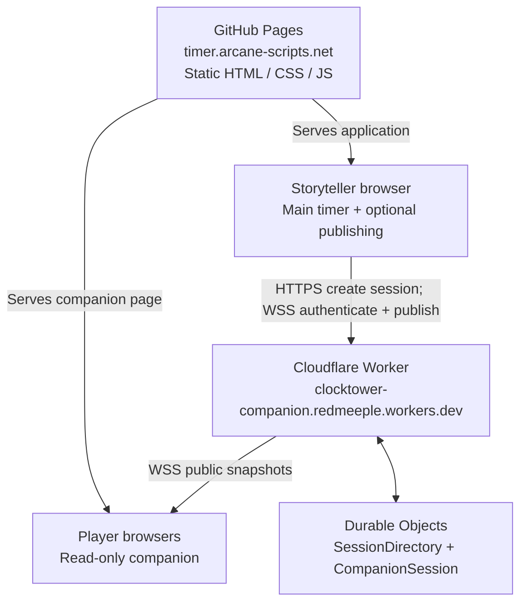
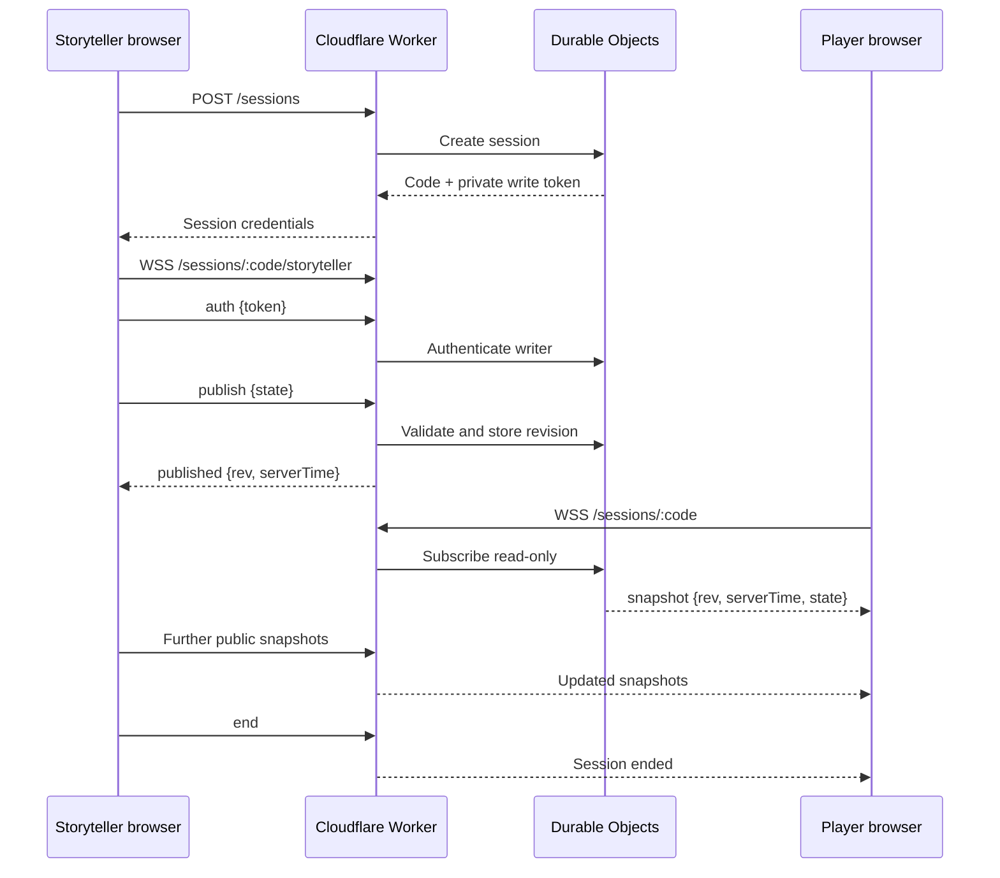

# Companion Mode — Architecture and Operations

> Living reference for the read-only, player-facing companion to Tower Timer. Update this document as the implementation evolves.

## Purpose

Companion Mode lets players view **public** game information on their own phones while a Storyteller runs the main timer. It is optional: the Storyteller's timer must continue to work if the companion service or internet connection fails.

The intended companion display includes:

- Day/night phase and day number.
- Public counts of Townsfolk, Outsiders, Minions, Demons, and Travellers (including zero).
- A countdown that follows the Storyteller's timer as closely as practical.
- Optional near-zero and zero alerts, subject to browser sound/vibration permissions and foreground/background limitations.
- Portrait-first layout with usable landscape support.

It must **not** expose private roles, Storyteller-only settings, or the session's write token.

## Hosting architecture

**GitHub Pages only serves static files.** It does not run a Node server, WebSocket server, or Durable Objects. The browser executes the timer and companion JavaScript; **Cloudflare Workers and Durable Objects** provide session management and live synchronisation.



Production connections go **directly from browsers to Cloudflare** using HTTPS and `wss://`. No GitHub Pages server or production reverse proxy is needed. `companion.html` allows that worker origin in its Content Security Policy. The Storyteller page does not, until sharing controls are added there. The Worker allows the site's exact Origin.

### Production endpoint

- Worker: `https://clocktower-companion.redmeeple.workers.dev`
- Storyteller application: `https://timer.arcane-scripts.net`
- Player-facing companion: `https://timer.arcane-scripts.net/companion.html?code=ABC123`
- A valid code in the address is normalised and joined automatically. Without a code, the page asks for one. The diagnostic client remains at `companion-dev.html`.

The `redmeeple` portion is the account-wide `workers.dev` subdomain; `clocktower-companion` is this Worker's name.

## Responsibilities and trust boundaries

| Component | Responsibility |
| --- | --- |
| Main timer (browser) | Owns authoritative game and timer state; works without Companion Mode. |
| Companion publishing adapter | Projects and validates **public** state; sends updates only when enabled. |
| Cloudflare Worker | Routes HTTP and WebSocket requests, enforces Origin restrictions and rate limits. |
| `SessionDirectory` Durable Object | Creates and tracks session codes; retires codes. |
| `CompanionSession` Durable Object | Authenticates the writer, retains latest snapshot, distributes revisions, handles expiry. |
| Companion page (browser) | Reads public snapshots and locally interpolates the countdown; cannot publish. |

The Storyteller receives a short session code and a separate private write token. Players need only the code. The token is sent in the first authenticated Storyteller WebSocket message, **not** in the URL. Readers have no publishing privileges.

### Session lifecycle



A companion page should use the latest authoritative snapshot, account for measured clock offset, and render a smooth local countdown rather than waiting for a server message every second. On reconnect, it should recover the latest snapshot. A locally calculated zero is **not** automatically authoritative dusk/end-of-day confirmation.

## Public state protocol

Protocol version 1 is a public projection, not the full internal game state. Example:

```json
{
  "v": 1,
  "phase": "day",
  "day": 3,
  "counts": {
    "townsfolk": 7,
    "outsider": 0,
    "minion": 2,
    "demon": 1,
    "traveller": 0
  },
  "timer": {
    "status": "running",
    "kind": "day",
    "remainingMs": 125400,
    "rate": 1
  }
}
```

The server wraps snapshots in a revisioned envelope with server timing information. The public schema and validation are implemented in `companionState.js`; countdown projection is in `companionClock.js`. Avoid sending full internal state or private information.

## Local development versus production

| Concern | Local development | Production |
| --- | --- | --- |
| Frontend hosting | `npm run dev:timer` at `http://127.0.0.1:8006` | GitHub Pages |
| Backend | `npm run dev:worker` or remote Cloudflare Worker | Remote Cloudflare Worker |
| Browser API/WebSocket URL | Same-origin `/companion-api` development proxy | Direct HTTPS / `wss://` Worker endpoint |
| Why a proxy? | Keeps the existing restrictive local CSP intact and supports local/remote backend selection | Not needed |
| Player page | `companion.html` on the local server, still via `/companion-api` | `companion.html` connects directly to the deployed worker |
| Publishing UI | Development-only `?companionDev=1` harness | Not on the Storyteller timer yet |

For a local Worker:

```bash
npm run dev:worker
npm run dev:timer
```

For the deployed Worker with the local frontend:

```bash
COMPANION_WORKER_URL='https://clocktower-companion.redmeeple.workers.dev' \
  npm run dev:timer
```

Then visit `http://127.0.0.1:8006/?companionDev=1`.

`companion.html` allows connections only to itself and `clocktower-companion.redmeeple.workers.dev` (HTTPS and WSS). On localhost it still uses the `/companion-api` proxy, so the same page works with a local worker or `COMPANION_WORKER_URL`. The Storyteller page's Content Security Policy is unchanged, because that page does not call the worker.

The companion can play a short sound and vibrate about 30 seconds before a running countdown reaches zero, and again at zero. Both are off until the player opts in, and only while the page is open and the phone is unlocked. "Keep the screen awake" is also off until asked for, and the browser may refuse it. Neither feature runs in the background.

## Deployment and verification

The Worker configuration is `worker/wrangler.jsonc`; Worker implementation and tests live under `worker/`. Cloudflare is the only required live server-side hosting provider.

```bash
npx wrangler login
npx wrangler whoami
npx wrangler deploy --config worker/wrangler.jsonc --dry-run
npx wrangler deploy --config worker/wrangler.jsonc
```

Health check:

```bash
curl -i https://clocktower-companion.redmeeple.workers.dev/health
```

Expected: HTTP `200` and `{"ok":true}`.

Remote session smoke test:

```bash
COMPANION_WORKER_URL='https://clocktower-companion.redmeeple.workers.dev' \
COMPANION_ORIGIN='https://timer.arcane-scripts.net' \
node scripts/companion-smoke.mjs
```

Expected: session code, `Published revision 1`, and `Session ended`.

### Deployment status — 13 October 2026

- Cloudflare Worker deployed successfully to `clocktower-companion.redmeeple.workers.dev`.
- `/health` returned HTTP 200 with `{"ok":true}`.
- Remote smoke test created a session, published revision 1, and ended the session.
- Remote two-window browser test confirmed Storyteller publishing and companion reception, with matching revisions.
- The player page is `companion.html`. It joins with a code and talks to the deployed worker when it is not served from localhost.
- Storyteller sharing controls are not on the main timer yet. A player needs the code some other way.

The `curl --max-time` timeout during a successful WebSocket upgrade is expected: WebSockets remain open. Receiving snapshot frames before that timeout demonstrates data delivery for that diagnostic connection, **not** a completed browser end-to-end test.

## Operational considerations

- The main timer remains authoritative and should never wait on Cloudflare to advance gameplay.
- Companion Mode should fail visibly but gracefully when disconnected or stale, without breaking the main timer.
- Browser tabs can be suspended; sound/vibration alerts and timely updates cannot be guaranteed when a phone is locked or the page is backgrounded. On return, refresh the displayed state and indicate missed completion where appropriate.
- Keep the private write token out of links, QR codes, logs, and player-facing state.
- The Worker currently uses Origin allowlisting, per-IP rate limits, session expiration, and reader/publish limits. See `worker/README.md` and the implementation for authoritative limits and deployment procedures.
- To inspect deployments or roll back:

```bash
npx wrangler deployments list --config worker/wrangler.jsonc
npx wrangler rollback --config worker/wrangler.jsonc
```

## Next steps

1. Add opt-in Storyteller session controls on the main timer, including a shareable link or QR code, and allow that page's Content Security Policy to reach the worker.
2. Validate the companion on real phones, including locked screens and background tabs. Alerts and the wake lock are foreground-only.
3. Decide whether the 30-second warning should follow a Storyteller setting instead of the fixed companion threshold.

## Useful source files

- `companionState.js` — public state projection and validation.
- `companionClock.js` — client-side countdown projection.
- `companionPublish.js` — opt-in publishing adapter.
- `companionTransport.js`, `companionClient.js`, `companionSync.js` — transport and synchronisation.
- `companion.html`, `companion.css`, `companion-page.js` — player page.
- `companionCode.js`, `companionDisplay.js`, `companionAlerts.js` — code entry, presentation and foreground warnings.
- `companionDev.js`, `companion-dev.html`, `companion-dev-page.js` — development harness.
- `scripts/dev-server.mjs` — local frontend server and `/companion-api` proxy.
- `scripts/companion-smoke.mjs` — remote smoke test.
- `worker/` — Cloudflare Worker, Durable Objects, Wrangler config and tests.

Keep this file aligned with the actual implementation and `worker/README.md`; it is an architectural guide, not a substitute for tests or source code.
