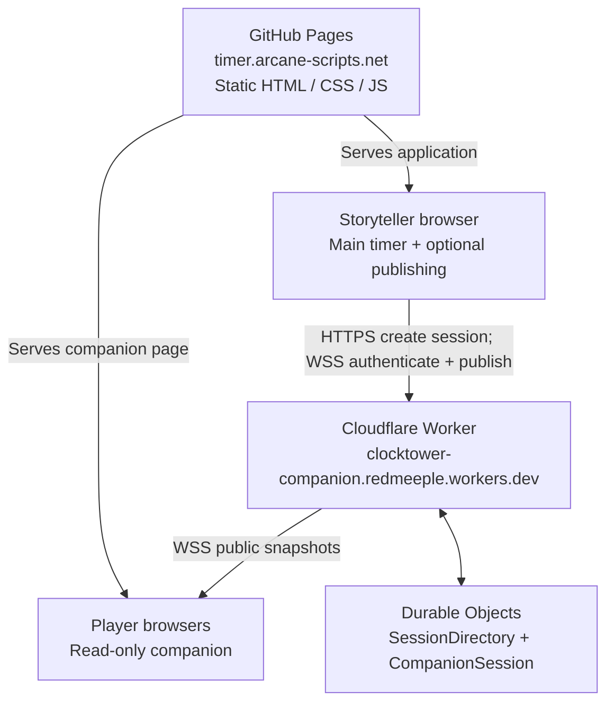
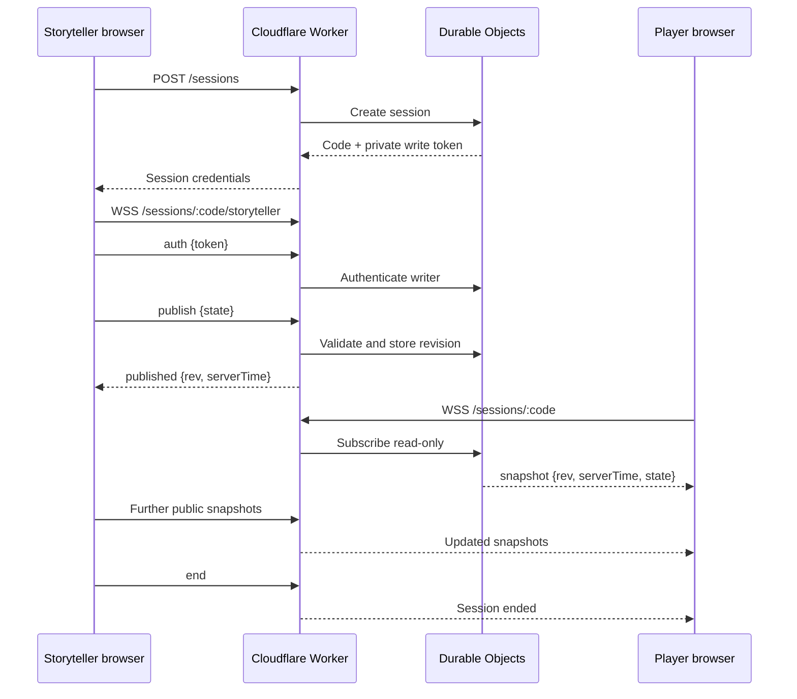

# Companion Mode — Architecture and Operations

> Living reference for the read-only, player-facing companion to Tower Timer. Update this document as the implementation evolves.

## Purpose

Companion Mode lets players view **public** game information on their own phones while a Storyteller runs the main timer. It is optional: the Storyteller's timer must continue to work if the companion service or internet connection fails.

The intended companion display includes:

- Day/night phase and day number.
- Public counts of Townsfolk, Outsiders, Minions, Demons, and Travellers (including zero).
- A countdown that follows the Storyteller's timer as closely as practical.
- Optional near-zero and zero alerts, subject to browser sound/vibration permissions and foreground/background limitations.
- Portrait-first layout with usable landscape support.

It must **not** expose private roles, Storyteller-only settings, or the session's write token.

## Hosting architecture

**GitHub Pages only serves static files.** It does not run a Node server, WebSocket server, or Durable Objects. The browser executes the timer and companion JavaScript; **Cloudflare Workers and Durable Objects** provide session management and live synchronisation.



Production connections go **directly from browsers to Cloudflare** using HTTPS and `wss://`. No GitHub Pages server or production reverse proxy is needed. Both the companion page and the Storyteller page allow that exact worker origin in `connect-src` (HTTPS and WSS, with no wildcard). The Worker allows the site's exact Origin.

### Production endpoint

- Worker: `https://clocktower-companion.redmeeple.workers.dev`
- Storyteller application: `https://timer.arcane-scripts.net`
- Player-facing companion: `https://timer.arcane-scripts.net/c`
- Direct session link: `https://timer.arcane-scripts.net/c?code=ABC123`
- The static file is `c/index.html`. Generated links use `/c` with no trailing slash. GitHub Pages may redirect `/c` to `/c/`; the page still loads, and a `code` query is preserved.
- A valid code in the address is normalised and joined automatically. Without a code, the page asks for one. The diagnostic client remains at `companion-dev.html`.

The `redmeeple` portion is the account-wide `workers.dev` subdomain; `clocktower-companion` is this Worker's name.

## Responsibilities and trust boundaries

| Component | Responsibility |
| --- | --- |
| Main timer (browser) | Owns authoritative game and timer state; works without Companion Mode. |
| Companion publishing adapter | Projects and validates **public** state; sends updates only when enabled. |
| Cloudflare Worker | Routes HTTP and WebSocket requests, enforces Origin restrictions and rate limits. |
| `SessionDirectory` Durable Object | Creates and tracks session codes; retires codes. |
| `CompanionSession` Durable Object | Authenticates the writer, retains latest snapshot, distributes revisions, handles expiry. |
| Companion page (browser) | Reads public snapshots and locally interpolates the countdown; cannot publish. |

The Storyteller receives a short session code and a separate private write token. Players need only the code. The token is sent in the first authenticated Storyteller WebSocket message, **not** in the URL. Readers have no publishing privileges.

### Session lifecycle



A companion page should use the latest authoritative snapshot, account for measured clock offset, and render a smooth local countdown rather than waiting for a server message every second. On reconnect, it should recover the latest snapshot. A locally calculated zero is **not** automatically authoritative dusk/end-of-day confirmation.

## Storyteller settings

Companion Mode is configured in the main timer's Settings dialog, on the **Companion** tab. Both settings are off until the Storyteller turns them on, and they are stored with the other timer settings.

While a session is live, the timer shows that session's six-character join code in a small panel just above the bottom-right controls. Players can read it without opening Settings. The panel stays hidden while Companion Mode is off, while sharing has not started, and while a session is still connecting. If the connection drops and that same session is reconnecting, the code remains and the panel says Reconnecting, so it is not shown as Live. The panel is removed when sharing stops, the session ends or expires, Companion Mode is turned off, or there is no valid code. Closing Settings, switching tabs, starting a new game, resetting the day, and pausing the countdown leave the code unchanged. The panel is read-only: it is not a control, and it does not create or end a session.

- **Enable Companion Mode** is the master switch. While it is off, the timer does not create a session, connect to the Worker, or publish. The session controls stay unavailable. Turning it off during an active session asks for confirmation, because players lose access. Cancelling that confirmation leaves the session running.
- **Start automatically** starts one sharing session when Tower Timer opens. It does nothing unless Companion Mode is also on. It runs once per page load, without opening Settings, and a failure leaves the timer playable so the Storyteller can press **Start sharing**. Starting a new game, resetting the day, or changing player or traveller counts does not create another session. Reloading the page does not reuse the previous write token; a new page load can receive a new code.

**Start sharing** creates the session and publishes the current public snapshot. The status moves through Connecting and only says Live after the Storyteller socket has connected and authenticated. **Stop sharing** ends that session for connected players and leaves Companion Mode enabled, so another session can be started. Closing Settings, or switching tabs, does not stop the session.

In Settings, the six-character code is shown while that session is connecting, live, or reconnecting. On the timer it appears only once the session is live, and it remains during reconnect. **Copy link** and **Show QR code** use the public player URL:

`https://timer.arcane-scripts.net/c?code=<SESSION_CODE>`

The link and the QR code contain the code and nothing else. The write token is not in the link, the QR image, the page, or the logs. The QR code can be closed without ending the session.

The same code stays in use across games in one evening. The public snapshot updates through the existing publishing points. A session ends when the Storyteller stops it, when Companion Mode is turned off, or when the Worker expires it (idle sessions end about three hours after the last accepted publish, and no session lasts longer than twelve hours). An expired or ended code is not shown as still valid, and the timer does not silently mint a replacement. The Storyteller starts a new session explicitly.

A network failure sets the status to Offline and does not stop the countdown.

## Public state protocol

Protocol version 1 is a public projection, not the full internal game state. Example:

```json
{
  "v": 1,
  "phase": "day",
  "day": 3,
  "counts": {
    "townsfolk": 7,
    "outsider": 0,
    "minion": 2,
    "demon": 1,
    "traveller": 0
  },
  "timer": {
    "status": "running",
    "kind": "day",
    "remainingMs": 125400,
    "rate": 1
  }
}
```

The server wraps snapshots in a revisioned envelope with server timing information. The public schema and validation are implemented in `js/companionState.js`; countdown projection is in `js/companionClock.js`. Avoid sending full internal state or private information.

## Local development versus production

| Concern | Local development | Production |
| --- | --- | --- |
| Frontend hosting | `npm run dev:timer` at `http://127.0.0.1:8006` | GitHub Pages |
| Backend | `npm run dev:worker` or remote Cloudflare Worker | Remote Cloudflare Worker |
| Browser API/WebSocket URL | Same-origin `/companion-api` development proxy | Direct HTTPS / `wss://` Worker endpoint |
| Why a proxy? | Local pages call same-origin `/companion-api`, including when `COMPANION_WORKER_URL` selects the deployed Worker | Not needed; the Storyteller page connects to the Worker directly |
| Player page | `c/index.html`, served at `/c`, `/c/` and `/c/index.html`, still via `/companion-api` | `/c` connects directly to the deployed worker |
| Publishing UI | Settings tab and the timer join code while a session is live, plus the development panel at `?companionDev=1` | Settings tab, off until enabled. The timer shows the join code only while a session is live |

For a local Worker:

```bash
npm run dev:worker
npm run dev:timer
```

For the deployed Worker with the local frontend:

```bash
COMPANION_WORKER_URL='https://clocktower-companion.redmeeple.workers.dev' \
  npm run dev:timer
```

Then visit `http://127.0.0.1:8006/?companionDev=1`. After a session starts, **Open companion** opens the player page and **Open diagnostics** opens the diagnostic client. Both use the current code and are not links once that session has ended. The panel and the Settings tab share one session controller, so they cannot start two sessions for the same page. The panel remains a localhost diagnostic tool. While the timer is showing the join code, the panel does not repeat that code. Its stop and drop actions are local diagnostic controls; **Stop sharing** in Settings is what tells the Worker to end the session for players.

The companion page at `/c` allows connections only to itself and `clocktower-companion.redmeeple.workers.dev` (HTTPS and WSS). On localhost it still uses the `/companion-api` proxy, so the same page works with a local worker or `COMPANION_WORKER_URL`. The Storyteller page allows the same worker host, for HTTPS and WSS only, and uses it when the page is not served from localhost. Locally, `http://127.0.0.1:8006/c`, `http://127.0.0.1:8006/c/` and `http://127.0.0.1:8006/c/index.html` all serve that page. A direct link is `http://127.0.0.1:8006/c?code=ABC123`.

The companion plays a singing bowl about 30 seconds before a running countdown reaches zero, and a church bell at zero. Vibration accompanies both. Both are off until the player opts in, and a sound is not played while the page is hidden. **Test sound** plays the bowl and then the bell so a player can check the device, and it does not turn the warning on or change the countdown. A missing file or a refused playback leaves the countdown running. **Keep screen on** is off until the player turns it on, and it is not stored: a new visit starts with it off, the same way the alert option does. Where the browser supports the Screen Wake Lock API, the page requests a lock while it is visible and releases that lock when the option is turned off or the page is hidden. It asks again when the page becomes visible, if the option is still on. The browser can refuse the lock. A browser without the API shows the option disabled, with a short explanation. Neither alerts nor the wake lock run in the background, and a refusal does not stop the countdown or the session.

A player whose session is live, or who is reconnecting after that session has already connected, can choose **Show QR code**. The code encodes `https://timer.arcane-scripts.net/c?code=<SESSION_CODE>` and nothing else. It stays available during a temporary reconnect, and it is removed when the session ends, expires, or the player leaves. The first connection attempt does not offer it until the session is established. The page footer says Made by Arcane Scripts and links to [https://arcane-scripts.net](https://arcane-scripts.net).

## Deployment and verification

The Worker configuration is `worker/wrangler.jsonc`; Worker implementation and tests live under `worker/`. Cloudflare is the only required live server-side hosting provider.

```bash
npx wrangler login
npx wrangler whoami
npx wrangler deploy --config worker/wrangler.jsonc --dry-run
npx wrangler deploy --config worker/wrangler.jsonc
```

Health check:

```bash
curl -i https://clocktower-companion.redmeeple.workers.dev/health
```

Expected: HTTP `200` and `{"ok":true}`.

Remote session smoke test:

```bash
COMPANION_WORKER_URL='https://clocktower-companion.redmeeple.workers.dev' \
COMPANION_ORIGIN='https://timer.arcane-scripts.net' \
node scripts/companion-smoke.mjs
```

Expected: session code, `Published revision 1`, and `Session ended`.

### Deployment status — 13 October 2026

- Cloudflare Worker deployed successfully to `clocktower-companion.redmeeple.workers.dev`.
- `/health` returned HTTP 200 with `{"ok":true}`.
- Remote smoke test created a session, published revision 1, and ended the session.
- Remote two-window browser test confirmed Storyteller publishing and companion reception, with matching revisions.
- The player page is `c/index.html`, published at `/c`. It joins with a code and talks to the deployed worker when it is not served from localhost.
- Storytellers turn sharing on from Settings. The timer face has no Companion Mode controls. While a session is live it shows the join code above the bottom-right controls. Sharing stays off until both the setting and a session exist.

The `curl --max-time` timeout during a successful WebSocket upgrade is expected: WebSockets remain open. Receiving snapshot frames before that timeout demonstrates data delivery for that diagnostic connection, **not** a completed browser end-to-end test.

## Operational considerations

- The main timer remains authoritative and should never wait on Cloudflare to advance gameplay.
- Companion Mode should fail visibly but gracefully when disconnected or stale, without breaking the main timer.
- Browser tabs can be suspended; sound/vibration alerts and timely updates cannot be guaranteed when a phone is locked or the page is backgrounded. On return, refresh the displayed state and indicate missed completion where appropriate.
- Keep the private write token out of links, QR codes, logs, and player-facing state.
- The Worker currently uses Origin allowlisting, per-IP rate limits, session expiration, and reader/publish limits. See `worker/README.md` and the implementation for authoritative limits and deployment procedures.
- To inspect deployments or roll back:

```bash
npx wrangler deployments list --config worker/wrangler.jsonc
npx wrangler rollback --config worker/wrangler.jsonc
```

## Known limitations

- Worker sessions expire. An idle session ends about three hours after the last accepted publish, and every session ends within twelve hours. The Settings tab then says the code is no longer valid. It does not create a replacement on its own.
- A reload does not restore the write token. Automatic start, when enabled, creates a new code for that page load.
- Alerts and Keep screen on work only while the player page is open and the phone is unlocked. Wake Lock is refused by some browsers, including iOS versions before 16.4, and it always ends when the page is hidden. Keep screen on does not claim the screen will stay awake when the browser cannot do it.
- The development panel is not part of the public timer. It appears only at `http://127.0.0.1:8006/?companionDev=1` or the localhost equivalent.

## Next steps

1. Validate the companion on real phones, including locked screens and background tabs. Alerts and the wake lock are foreground-only.
2. Decide whether the 30-second warning should follow a Storyteller setting instead of the fixed companion threshold.

## Useful source files

- `js/companionState.js` — public state projection and validation.
- `js/companionClock.js` — client-side countdown projection.
- `js/companionPublish.js` — opt-in publishing adapter.
- `js/companionTransport.js`, `js/companionClient.js`, `js/companionSync.js` — transport and synchronisation.
- `c/index.html`, `css/companion.css`, `js/companion-page.js` — player page. The public URL is `/c`.
- `js/companionCode.js`, `js/companionDisplay.js`, `js/companionAlerts.js`, `js/companionSound.js`, `js/companionWake.js` — code entry, presentation, foreground warnings, player sound effects, and the screen wake lock. The public player URL and its QR image are built in `companionCode.js` and reused by the Storyteller session.
- `js/companionSession.js` — the single Storyteller session used by Settings and the development panel.
- `js/companionDev.js`, `companion-dev.html`, `js/companion-dev-page.js` — development harness.
- `scripts/dev-server.mjs` — local frontend server and `/companion-api` proxy.
- `scripts/companion-smoke.mjs` — remote smoke test.
- `worker/` — Cloudflare Worker, Durable Objects, Wrangler config and tests.

Keep this file aligned with the actual implementation and `worker/README.md`; it is an architectural guide, not a substitute for tests or source code.
